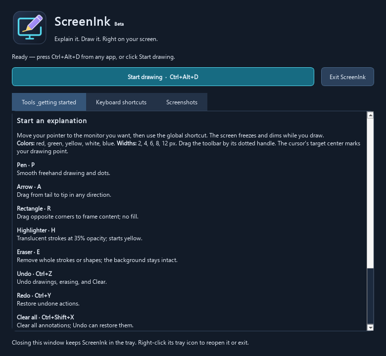
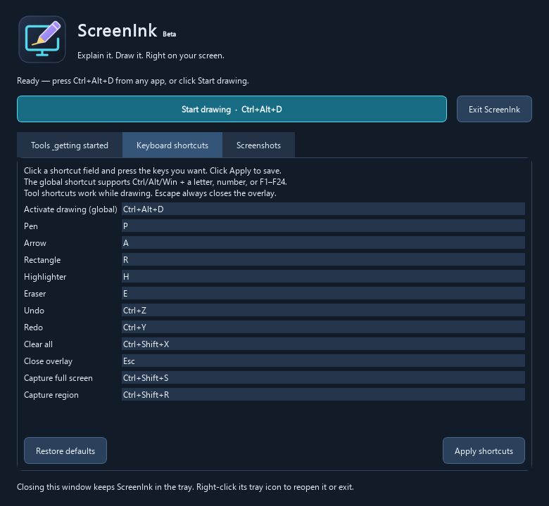

<p align="center">
  
</p>

<h1 align="center">ScreenInk</h1>
<p align="center"><strong>Explain it. Draw it. Right on your screen.</strong></p>
<p align="center">A portable Windows screen annotation tool for teachers, creators, developers, and students.</p>
<p align="center">
  <a href="https://github.com/Dineth-ng/ScreenInk/releases">Download beta</a> ·
  <a href="#quick-start">Quick start</a> ·
  <a href="docs/BETA_TESTING.md">Tester guide</a> ·
  <a href="https://github.com/Dineth-ng/ScreenInk/issues">Report a bug</a>
</p>

---

**Current test version: 0.3.0-beta.1 · Windows x64 · Python + PySide6 / Qt 6**

Press **Ctrl+Alt+D** to freeze the monitor under your pointer and start drawing.
Highlight a code block, point out a command, or sketch an explanation during a
tutorial. Press **Escape** to return to your desktop; ScreenInk stays in the tray.

## Download the Windows beta

Get **ScreenInk-0.3.0-beta.1-windows-x64.zip** from
[GitHub Releases](https://github.com/Dineth-ng/ScreenInk/releases).

- Portable build: no Python installation or administrator privileges required.
- Target platform: Windows 10/11, 64-bit x64. Clean-machine testing is still needed.
- Includes the executable, runtime files, tester guide, and README.
- A companion `.sha256` file lets you verify the download.

This beta is unsigned, so Windows may show an unknown-publisher warning. Check
the download source and checksum before deciding whether to run it.

```powershell
Get-FileHash .\ScreenInk-0.3.0-beta.1-windows-x64.zip -Algorithm SHA256
```

Compare the result with the published `.sha256` file.

## Quick start

1. Extract the **complete ZIP** to a folder.
2. Open `ScreenInk` and double-click **ScreenInk.exe**. Keep its `_internal` folder beside it.
3. The main window opens with a tool guide, **Start drawing**, and **Keyboard shortcuts** settings. A tray icon also appears.
4. Move your pointer to the monitor to annotate and press **Ctrl+Alt+D**.
5. Select a tool, color, and width. Draw using the left mouse button.
6. Press **Escape** to close the overlay, or right-click the tray icon → **Exit** to quit.

Run the executable from the extracted folder, not from inside the ZIP. You can
create a Windows shortcut to `ScreenInk.exe` for convenient access.

## Change your shortcuts

Open **Keyboard shortcuts** in the main window. Click a field, press your desired
combination, then click **Apply shortcuts**. You can change activation, Pen, Arrow,
Rectangle, Highlighter, Eraser, Undo, Redo, Clear, and Close. **Restore defaults**
fills in the original bindings; click Apply to save them.

The activation shortcut works globally and supports Ctrl, Alt, or Win with a
letter, number, or F1–F24 (Shift can also be included). Tool shortcuts work only
inside the overlay. Duplicates and invalid combinations are rejected. If another
app owns the new global shortcut, the previous registration stays active.
Settings are saved per Windows user and restored on the next launch. Escape
always closes the overlay, even if you choose another Close shortcut.





Closing the main window hides it to the tray. Double-click the tray icon or choose
**Open ScreenInk / Settings** to reopen it. Use **Exit ScreenInk** or tray **Exit**
to quit. Opening the main window while drawing closes the overlay and discards
that drawing session.

## Drawing tools (default shortcuts)

| Tool | Shortcut | Use it to… |
| --- | --- | --- |
| Pen | **P** | Draw smooth, antialiased strokes and dots. |
| Arrow | **A** | Drag from tail to tip with a live preview in any direction. |
| Rectangle | **R** | Frame code or content with a colored border and transparent interior. |
| Highlighter | **H** | Mark content at approximately 35% opacity; starts yellow at 12 px. |
| Object eraser | **E** | Click to remove the topmost annotation or drag across several objects. |
| Undo | **Ctrl+Z** | Undo drawing, erasing, or Clear; repeat for earlier actions. |
| Redo | **Ctrl+Y** | Restore undone actions. New edits discard the old redo branch. |
| Clear all | **Ctrl+Shift+X** | Remove all annotations without closing the overlay. Undo restores them. |
| Capture full screen | **Ctrl+Shift+S** | Preview the annotated monitor, then Save a PNG or Copy the image. |
| Capture region | **Ctrl+Shift+R** | Drag a region in any direction; preview its image. Escape cancels selection. |
| Close overlay | **Escape** | Return to the desktop while ScreenInk stays in the tray. |


## Screenshots — Milestone 3

Click the **camera** button or press **Ctrl+Shift+S** while drawing for a full
annotated-monitor screenshot. Use the **region** button or **Ctrl+Shift+R** to
select an area. A border and physical-pixel dimensions appear while dragging.
Drag in any direction; click-only/zero-size selections are ignored. **Escape
cancels selection without closing the drawing overlay.**

The lightweight preview offers **Save**, **Copy**, and **Cancel**:

- **Save:** opens Save As with `ScreenInk_YYYY-MM-DD_HHMMSS.png`, using your computer's local date/time. Choose a `.png` filename and folder. PNG encoding runs on a worker thread; success is confirmed in the preview and a small notification. Save errors keep the preview available for retry and atomic writes protect an existing file.
- **Copy:** places image pixels on the Qt system clipboard. Paste with Ctrl+V into Paint, Word, PowerPoint, Discord, or another image-capable app. No filename/path is copied.
- **Cancel:** returns to drawing with the same annotations and undo/redo history. Captures and saves do not close ScreenInk. Close the preview to take another capture.

The home window's **Screenshots** tab controls whether exports include the 25%
background dimming (on by default). The screen overlay itself remains dimmed.
PNG is the current format. Dimming, format, and the last successful save folder
are stored per Windows user using the existing QSettings system. Capture shortcuts
can be changed in **Keyboard shortcuts**, alongside the drawing shortcuts.

Exports reuse the original frozen screen pixels, then optionally add dimming and
paint the same annotation objects onto a separate QImage. They never grab the
toolbar, preview, region UI, notifications, or mouse cursor. The background stays
unchanged. Active drawing gestures are finalized when you explicitly capture.
The full image keeps the original physical resolution; logical annotation and
selection coordinates map through the actual image-to-canvas ratio. Fractional
DPI crops round outward to include the selection boundary and clamp to the image.

ScreenInk supports **one selected monitor per overlay**, not a stitched desktop
or a region spanning monitors. Real 125%/150% scaling, native Save As focus, and
clipboard pasting into other Windows applications still need interactive testing.
The image is a freeze-frame from overlay activation, not a later live desktop frame.
All screenshot pixels stay local: no uploads, content logging, cloud sync, or
automatic background capture is implemented. Your explicit Copy action places
the image on the OS clipboard; OS clipboard-history/sync settings are outside the app.

See the [Milestone 3 component guide and manual checklist](docs/CAPTURE.md).

### Built for explanations

- **Five colors:** red, green, yellow, white, and blue.
- **Five widths:** 2, 4, 6, 8, and 12 logical pixels.
- **Compact dark toolbar:** icon buttons, selected-tool indicator, and a draggable six-dot handle.
- **Tool-aware cursors:** an icon badge shows the tool; the target center marks the exact drawing position.
- **Readable background:** the frozen screen is darkened by approximately 25% while ink stays visible.
- **Independent objects:** erasing never changes the original background; a rectangle's interior is not an eraser target.
- **Tray workflow:** shortcut failure has a tray-menu fallback, and duplicate instances are prevented.

Each drawing tool remembers its own settings during an overlay session. Existing
annotations keep their original style. Switching tools cancels an unfinished
drawing preview. An eraser drag is grouped into one undo action.

## Beta limitations

- Closing the overlay discards annotations and undo history; reopening starts fresh.
- One selected monitor is covered at a time. Mixed-DPI configurations need real desktop testing.
- The background is frozen; the overlay does not pass clicks to the app beneath it.
- PNG image export is available; editable annotation sessions are not saved. No recording, text tool, installer, auto-updater, or code signing yet.
- Protected content, UAC secure desktop, and some exclusive fullscreen apps may block capture or overlays.
- If Ctrl+Alt+D is already registered, use **Start drawing** from the tray; restart after resolving the conflict.

## Run from source

Use Python 3.11 or newer on Windows. In PowerShell:

```powershell
git clone https://github.com/Dineth-ng/ScreenInk.git
cd ScreenInk
python -m venv .venv
.\.venv\Scripts\python.exe -m pip install -r requirements.txt
.\.venv\Scripts\python.exe main.py
```

No virtual-environment activation is needed. For a launch without a console:

```powershell
Start-Process -FilePath .\.venv\Scripts\pythonw.exe -ArgumentList main.py -WorkingDirectory (Get-Location).Path
```

## Build the portable beta

Build on Windows x64 from the project folder:

```powershell
.\.venv\Scripts\python.exe -m pip install -r requirements-build.txt
.\.venv\Scripts\python.exe tools\build_beta.py
```

Outputs:

```text
dist/ScreenInk/ScreenInk.exe
release/ScreenInk-0.3.0-beta.1-windows-x64.zip
release/ScreenInk-0.3.0-beta.1-windows-x64.sha256
```

PyInstaller bundles the runtime into a portable folder, sets the executable icon
and Windows version properties, then the build script creates the ZIP and hash.
Generated builds are excluded from Git; distribute the ZIP through Releases.
Edit `screenink/assets/screenink.svg` and run `tools/generate_icon.py` to regenerate
the PNG and multi-resolution Windows ICO.

## Test and contribute

```powershell
.\.venv\Scripts\python.exe -m unittest discover -s tests -v
.\.venv\Scripts\python.exe main.py --smoke-test
.\dist\ScreenInk\ScreenInk.exe --smoke-test
```

The 33 regression tests cover native-resolution image composition, 125%/150%
coordinate mapping, all region drag directions, selection cancellation, PNG round
trips, simulated permission/disk failures, atomic preservation of existing files,
clipboard image data, repeated captures, screenshot preferences, and geometry,
transparency, styles, erasing,
history, toolbar input, custom shortcuts, settings persistence, safe hotkey
replacement, and fresh sessions. The smoke command
checks startup, bundled icon loading, tool rendering, and history without opening
a desktop overlay or registering the global shortcut; exit code 0 means success.
Offscreen tests cannot confirm real desktop focus, tray interaction, global
shortcut delivery, or mixed-DPI behavior.

Use the [beta checklist](docs/BETA_TESTING.md) on a real Windows desktop. Report
bugs through [GitHub Issues](https://github.com/Dineth-ng/ScreenInk/issues), including
the beta version, Windows version, display scaling, reproduction steps, and
expected/actual behavior.

## Project map

```text
screenink/
  application.py    Tray, instance lock, capture, and app lifetime
  window.py         Startup interface, tool guide, and shortcut editor
  settings.py       Shortcut validation and saved per-user preferences
  overlay.py        Fullscreen window and local shortcuts
  drawing.py        Canvas input forwarding and rendering
  interaction.py    Tool settings, gestures, and live previews
  annotations.py    Independent annotation geometry and hit testing
  history.py        Undo/redo document state
  toolbar.py        Draggable controls
  icons.py          Shared tool icon artwork
  cursors.py        Tool-aware mouse cursors
  capture.py        Capture orchestration and feedback
  composition.py    Original image + dimming + annotation compositing
  region_selection.py  Interactive selection border and pixel dimensions
  capture_preview.py   Nonblocking preview and Save As dialog
  exporting.py      Atomic background PNG writer
  clipboard.py      Image-data clipboard operations
  branding.py       Application icon loader
  version.py        Beta version
  smoke_test.py     Packaged startup check
  hotkey.py         Windows global shortcut registration
  assets/           SVG, PNG, and multi-resolution ICO
tools/              Icon generator and Windows build script
packaging/          Windows version metadata and release notes
tests/              Automated drawing regression tests
docs/               Developer notes and beta tester guide
```

See [developer notes](docs/DEVELOPMENT.md) for the drawing architecture and the
detailed Milestone 2 manual checklist.
