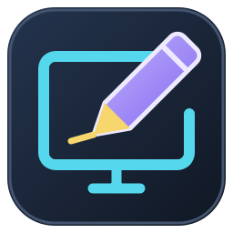
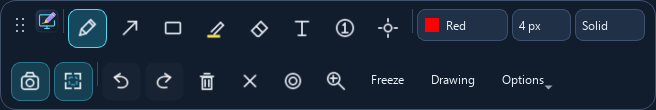

<p align="center"></p>
<h1 align="center">ScreenInk</h1>
<p align="center"><strong>Explain it. Draw it. Right on your screen.</strong></p>
<p align="center">A portable Windows annotation and presentation tool built with Python and PySide6.</p>

**0.4.0-beta.1 | Windows 10/11 x64 | Milestone 4 test build**

[Download beta](https://github.com/Dineth-ng/ScreenInk/releases) · [Presentation guide](docs/PRESENTATION.md) · [Report a bug](https://github.com/Dineth-ng/ScreenInk/issues)



## Start in a minute

1. Download `ScreenInk-0.4.0-beta.1-windows-x64.zip` from Releases.
2. Extract the **whole ZIP**. Keep the EXE, adjacent runtime DLLs, and `_internal` folder together.
3. Run `ScreenInk.exe`. The home window explains the tools and lets you change shortcuts.
4. Move the mouse to your chosen monitor, then press **Ctrl+Alt+D**.
5. Draw on the frozen screen, or press **F** to let the desktop keep updating behind your annotations.
6. Press **Escape** to close drawing. ScreenInk stays in the tray; tray **Exit** quits.

No Python installation or administrator privileges are required for the portable build. It is an unsigned beta; clean-machine and interactive Windows testing are still needed. The companion `.sha256` file can be compared with:

```powershell
Get-FileHash .\ScreenInk-0.4.0-beta.1-windows-x64.zip -Algorithm SHA256
```

## Tools and default shortcuts

| Action | Key | How it works |
| --- | --- | --- |
| Activate | Ctrl+Alt+D | Capture the monitor under the mouse and open drawing. Also restores Drawing mode. |
| Pen | P | Smooth freehand lines. Choose Solid, Dashed, Dotted, or Marker. |
| Arrow | A | Drag from tail to tip in any direction. |
| Rectangle | R | Drag opposite corners; the inside stays transparent. |
| Highlighter | H | Translucent strokes at 35% opacity, initially yellow. |
| Object eraser | E | Remove complete strokes, text, shapes, or markers. |
| Text | T | Click, type, and Apply. Choose font size, color, and bold in the editor. |
| Numbered steps | N | Click to place consecutive numbered circles. |
| Spotlight | S | Toggle a clear focus area. Drag to move; wheel to resize. |
| Magnifier | M | Toggle a movable lens over the original frozen image. |
| Laser pointer | L | Drag a glowing trail that fades in about 0.9 seconds. |
| Freeze / Live | F | Switch between a frozen image and a continuously updating desktop. |
| Drawing / Pointer | Ctrl+Space | In Live mode, switch between drawing input and real click-through. |
| Undo / Redo | Ctrl+Z / Ctrl+Y | Restore edits, moves, deletions, and Clear. |
| Clear annotations | Ctrl+Shift+X | Remove annotations; undo restores them. |
| Full screenshot | Ctrl+Shift+S | Preview, Save PNG, or Copy image pixels. |
| Region screenshot | Ctrl+Shift+R | Drag an area; Escape cancels selection. |
| Delete selected text/step | Delete or Backspace | Select or drag an existing object with its own tool first. |
| Close | Escape | Close the overlay; a text editor/selection/preview cancels first. |

### Colors and pen styles

Choose **12 presets**: red, green, yellow, white, blue, cyan, orange, pink, purple, lime, teal, and black. Choose **Custom...** for any RGB/hex color. Each tool remembers its color during the session. Permanent annotations preserve their original colors and styles.

Brush widths are **2, 4, 6, 8, and 12 logical pixels**. The style selector affects Pen: solid, dashed, dotted, or a 35%-opacity marker. Highlighter is also translucent. Laser is a separate temporary tool; it does not enter undo history or screenshot exports.

### Presentation controls

- **Spotlight:** Options selects circle/rectangle and 10-90% dimming. Select a drawing tool to annotate while keeping the spotlight visible. Toggle S off to remove the mask without clearing ink. Spotlight and lens are presentation effects, outside annotation history.
- **Text:** drag existing text to move it; double-click with Text selected to edit. Apply, Delete, and Cancel are explicit. Typing stays inside the editor. Existing text color can be changed in the editor; choose any custom color on the toolbar before creating new text.
- **Steps:** Options sets diameter (24-72 px) or resets the next number to 1. Drag an existing marker to move it. After document edits, the next number follows the last remaining marker; Undo/Redo restores placed objects.
- **Magnifier:** Options selects 2x, 3x, or 4x and **Export lens**. Drag the lens to move it. It is bounded to the screen and samples original pixels only. Available in Freeze mode; entering Live turns it off.
- **Toolbar:** drag the dotted handle. Two compact rows wrap further on narrow logical screens. Options holds presentation settings.

## Live mode and pointer recovery

Freeze starts with a captured image and about 25% dimming. Live uses a transparent, always-on-top window so the actual desktop continues updating. It does not repeatedly capture the screen. Drawing mode intercepts input; Windows requires a nearly transparent 1/255 backing alpha to keep the whole drawing surface mouse-sensitive.

In Live mode, **Ctrl+Space** enables real Windows layered-window click-through. The toolbar remains visible but also passes clicks through. Press Ctrl+Space again, use your activation shortcut, or right-click the tray and choose **Return to Drawing Mode** to regain input. If the pointer hotkey cannot register, a notification explains the tray fallback. Escape is a local overlay key: while another application owns focus in Pointer mode, restore Drawing first, then Escape.

Returning from Live to Freeze captures a fresh frame after briefly hiding ScreenInk. Annotations keep their monitor-local coordinates; they are not attached to moving windows or document content. One selected monitor is supported per overlay, including monitors with negative desktop coordinates. Monitor layout changes require closing and reopening the overlay.

## Screenshots

Use the camera or region button, then **Save**, **Copy**, or **Cancel**. Save suggests `ScreenInk_YYYY-MM-DD_HHMMSS.png` using the computer's local time. PNG encoding runs on a worker thread, and atomic writes protect existing files if saving fails. The last successful folder is remembered. Copy places actual image pixels on the clipboard.

Freeze exports compose the original pixels and annotation objects. Live exports use a separate one-shot capture: hide ScreenInk briefly, capture the selected monitor, restore ScreenInk, and compose the captured frame with the annotations. Region selection temporarily shows that captured frame; closing the preview restores Live mode.

Exports exclude toolbar, selection UI, preview, cursor, notifications, and laser trails. Text and step markers are included. **Options > Export lens** includes the enabled lens when requested. **Screenshots > Include background dimming** controls normal dimming or the active spotlight mask in exports.

Images retain native pixel resolution. Fractional-DPI regions round outward and clamp to the image. No recordings, uploads, telemetry, cloud services, or automatic background capture are included. OS clipboard history/sync is controlled by Windows.

## Customize shortcuts

Open the home window's **Keyboard shortcuts** tab, edit keys, and click **Apply shortcuts**. All named actions in the table except Delete/Backspace are configurable. Activation and pointer recovery need Ctrl/Alt/Win plus a letter, digit, Space, or F1-F24. Pointer recovery is global only while the overlay exists. Duplicate shortcuts are rejected. Existing custom keys are preserved during upgrades; new actions receive unused alternatives when needed.

Main-window Close hides it to the tray. Opening Settings while annotating closes that session, so save first. Closing an overlay discards annotations and undo history; there is no editable-session saving.

## Run and test from source

Use Python 3.11+ on Windows:

```powershell
git clone https://github.com/Dineth-ng/ScreenInk.git
cd ScreenInk
python -m venv .venv
.\.venv\Scripts\python.exe -m pip install -r requirements.txt
.\.venv\Scripts\python.exe main.py
```

```powershell
.\.venv\Scripts\python.exe -m unittest discover -s tests -v
.\.venv\Scripts\python.exe -m compileall -q main.py screenink tests
.\.venv\Scripts\python.exe main.py --smoke-test
```

Tests cover drawing, history, styles, editor isolation, spotlight, magnifier, text/steps, laser expiry, live-mode state and capture failures, mocked native pointer flags, PNG/clipboard composition, fractional scaling, shortcuts, and toolbar wrapping. Offscreen and mocked checks **do not verify actual Windows click-through, global key delivery, compositor behavior, desktop focus, or mixed-DPI hardware**. Follow the [manual presentation checklist](docs/PRESENTATION.md) before relying on Live/Pointer mode in a lesson.

## Build the EXE

```powershell
.\.venv\Scripts\python.exe -m pip install -r requirements-build.txt
.\.venv\Scripts\python.exe tools\build_beta.py
.\dist\ScreenInk\ScreenInk.exe --smoke-test
```

Outputs: `dist/ScreenInk/ScreenInk.exe`, `release/ScreenInk-0.4.0-beta.1-windows-x64.zip`, and its SHA-256 file. The build validates synthetic startup without capturing the user's desktop. No new runtime dependency was added.

## Platform limits

- Live/Pointer behavior and live screenshot timing need real Windows validation. The 200 ms hide delay is a best-effort compositor delay, not a Windows Graphics Capture synchronization guarantee. The capture provider is isolated for future platform-specific work.
- No live magnifier polling, cross-monitor stitching, editable-session persistence, recording, installer, auto-update, or code signing.
- Protected content, secure desktop/UAC, remote sessions, exclusive fullscreen applications, or elevated applications may behave differently or prevent capture/input. Close/reopen after display-layout changes.
- Long text can exceed the viewport; use a smaller font or shorter lines. Text uses installed system fonts, so metrics may differ across machines.

## Project map

| File | Responsibility |
| --- | --- |
| `application.py`, `window.py` | App/tray lifecycle, home and settings UI |
| `hotkey.py`, `settings.py` | Windows global keys and saved preferences |
| `overlay.py`, `drawing.py` | Overlay coordination and canvas painting |
| `interaction.py`, `history.py` | Mouse gestures and undoable document edits |
| `annotations.py` | Existing pen/arrow/rectangle/highlighter objects |
| `teaching_annotations.py`, `text_editor.py` | Text/marker geometry, rendering, and temporary editor |
| `spotlight.py`, `magnifier.py`, `laser.py` | Separate presentation effects |
| `display_modes.py`, `passthrough.py` | Freeze/live and one-shot capture; native Windows input passthrough |
| `toolbar.py`, `wrap_layout.py`, `icons.py`, `cursors.py`, `palette.py` | Controls, wrapping, icons, cursor badges, and colors |
| `capture.py`, `composition.py`, `region_selection.py` | Capture workflow, native-resolution composition, selection |
| `capture_preview.py`, `exporting.py`, `clipboard.py` | Preview, asynchronous atomic PNG saves, image clipboard |
| `branding.py`, `version.py`, `smoke_test.py` | Identity/version and packaged smoke check |
| `tools/`, `packaging/`, `tests/`, `docs/` | Build helpers, release metadata, tests, and guides |

Python modules above are in `screenink/`. Earlier architecture notes: [drawing](docs/DEVELOPMENT.md) and [capture](docs/CAPTURE.md).
